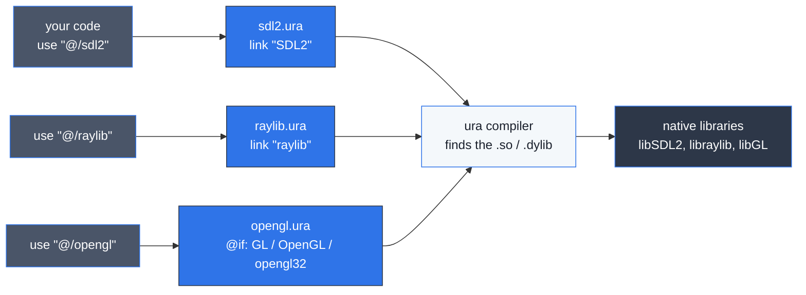
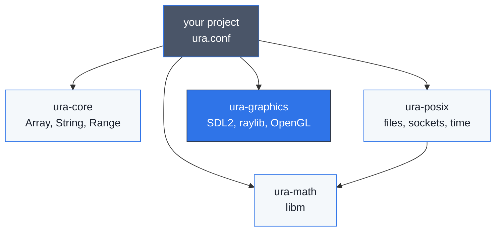

<p align="center">
  
</p>

<h1 align="center">ura-graphics</h1>

<p align="center">
  Windows, pixels and games for <a href="https://github.com/mohammedhrima/ura-lang">ura</a>: SDL2, raylib and OpenGL bindings.<br>
  Open a window, fill a pixel buffer, draw shapes and text, all from ura.
</p>

<p align="center">
  
  
  
  
  
</p>

---

## At a glance

A 320x200 plasma that animates for three seconds, written straight into a pixel buffer:

```ura
use "@/sdl2"

W i32 = 320
H i32 = 200

fn main() i32:
    SDL_Init(SDL_INIT_VIDEO)
    window i8[] = SDL_CreateWindow("ura plasma", SDL_WINDOWPOS_CENTERED, SDL_WINDOWPOS_CENTERED, W * 2, H * 2, SDL_WINDOW_SHOWN)
    renderer i8[] = SDL_CreateRenderer(window, -1, SDL_RENDERER_ACCELERATED)
    texture i8[] = SDL_CreateTexture(renderer, SDL_PIXELFORMAT_RGBA8888, SDL_TEXTUREACCESS_STREAMING, W, H)
    pixels Array<u32>
    pixels.resize(W * H)
    event SDL_Event
    none i8[]
    frames i32 = 0

    while SDL_GetTicks() < 3000:
        while SDL_PollEvent(&event) != 0:
            frames += 0
        t i32 = (SDL_GetTicks() / 10) as i32
        for y in Range::create(0, H):
            for x in Range::create(0, W):
                red u32 = ((x + t) % 256) as u32
                green u32 = ((y + t / 2) % 256) as u32
                blue u32 = ((x + y + t) % 256) as u32
                pixels[y * W + x] = red * 16777216 + green * 65536 + blue * 256 + 255
        SDL_UpdateTexture(texture, none, pixels.data as i8[], W * 4)
        SDL_RenderCopy(renderer, texture, none, none)
        SDL_RenderPresent(renderer)
        frames += 1

    output("drew ", frames, " frames of ", W, "x", H, " pixels\n")
    SDL_DestroyTexture(texture)
    SDL_DestroyRenderer(renderer)
    SDL_DestroyWindow(window)
    SDL_Quit()
    return 0
```

- `pixels Array<u32>` is a ura array; `pixels.data` hands its memory to SDL with no copy.
- One `u32` per pixel, `RGBA8888`: red in the top byte, alpha in the low byte.
- The window is freed by SDL's own destroy calls; the pixel array is freed by ura at the end of `main`.

## Install

```
ura install ura-graphics 0.1.0 https://github.com/mohammedhrima/ura-graphics
```

It adds this line to your project's `ura.conf`. The C library itself comes from your system (`apt install libsdl2-dev`, `brew install sdl2 raylib`).

```ura
@dependency "ura-graphics" "0.1.0" "https://github.com/mohammedhrima/ura-graphics"
```

## Frame pipeline

```
 ura                                   SDL2                          screen
┌────────────────────────┐   .data   ┌──────────────────────┐      ┌────────┐
│ pixels Array<u32>      │ ────────► │ SDL_UpdateTexture    │      │        │
│ [RGBA][RGBA][RGBA] ... │  no copy  │ texture (GPU)        │ ───► │ window │
│ W * H elements         │           │ SDL_RenderCopy       │      │        │
└────────────────────────┘           │ SDL_RenderPresent    │      └────────┘
          ▲                          └──────────────────────┘
          └──────────── for y, for x: compute each pixel, every frame
```



## API quick reference

| Module | Import | Key types and functions | Notes |
|---|---|---|---|
| sdl2 | `use "@/sdl2"` | `SDL_CreateWindow` `SDL_CreateRenderer` `SDL_CreateTexture` `SDL_UpdateTexture` `SDL_PollEvent`, `SDL_Event` | windows, pixels, keyboard, mouse, timers |
| raylib | `use "@/raylib"` | `InitWindow` `BeginDrawing` `DrawRectangle` `DrawText` `IsKeyPressed` | the quickest way to a small game |
| opengl | `use "@/opengl"` | `glClear` `glBegin` `glVertex` `glColor` `glOrtho` `glBindTexture` | classic OpenGL 1.x, with an SDL2 OpenGL context |

<details>
<summary><b>sdl2</b>: every binding</summary>

| Area | Functions | Constants |
|---|---|---|
| setup | `SDL_Init` `SDL_Quit` `SDL_GetError` | `SDL_INIT_TIMER` `SDL_INIT_AUDIO` `SDL_INIT_VIDEO` `SDL_INIT_EVENTS` |
| windows | `SDL_CreateWindow` `SDL_DestroyWindow` `SDL_SetWindowTitle` `SDL_GetWindowSize` `SDL_ShowCursor` | `SDL_WINDOWPOS_CENTERED` `SDL_WINDOWPOS_UNDEFINED` `SDL_WINDOW_SHOWN` `SDL_WINDOW_RESIZABLE` `SDL_WINDOW_FULLSCREEN` `SDL_WINDOW_OPENGL` |
| drawing | `SDL_CreateRenderer` `SDL_DestroyRenderer` `SDL_SetRenderDrawColor` `SDL_RenderClear` `SDL_RenderPresent` `SDL_RenderDrawPoint` `SDL_RenderDrawLine` `SDL_RenderDrawRect` `SDL_RenderFillRect` | `SDL_RENDERER_SOFTWARE` `SDL_RENDERER_ACCELERATED` `SDL_RENDERER_PRESENTVSYNC` |
| textures | `SDL_CreateTexture` `SDL_UpdateTexture` `SDL_RenderCopy` `SDL_DestroyTexture` | `SDL_PIXELFORMAT_RGBA8888` `SDL_PIXELFORMAT_ARGB8888` `SDL_TEXTUREACCESS_STATIC` `SDL_TEXTUREACCESS_STREAMING` |
| events | `SDL_PollEvent` `SDL_WaitEvent` | `SDL_QUIT` `SDL_KEYDOWN` `SDL_KEYUP` `SDL_MOUSEMOTION` `SDL_MOUSEBUTTONDOWN` `SDL_MOUSEBUTTONUP` `SDL_WINDOWEVENT` |
| keyboard | `SDL_GetKeyboardState` | `SDL_SCANCODE_W` `A` `S` `D` `UP` `DOWN` `LEFT` `RIGHT` `SPACE` `ESCAPE` |
| time | `SDL_GetTicks` `SDL_Delay` | |
| OpenGL context | `SDL_GL_*` | `SDL_GL_DOUBLEBUFFER` `SDL_GL_DEPTH_SIZE` `SDL_GL_CONTEXT_MAJOR_VERSION` `SDL_GL_CONTEXT_PROFILE_CORE`... |

</details>

<details>
<summary><b>raylib</b>: every binding</summary>

`InitWindow` `CloseWindow` `WindowShouldClose` `SetTargetFPS` `GetFrameTime` `BeginDrawing` `EndDrawing` `ClearBackground` `DrawRectangle` `DrawRectangleLines` `DrawLine` `DrawText` `MeasureText` `IsKeyPressed` `ColorBrightness` `TextFormat` `SetRandomSeed` `GetRandomValue`, and the keys `KEY_LEFT` `KEY_RIGHT` `KEY_UP` `KEY_DOWN` `KEY_SPACE` `KEY_P` `KEY_R`

</details>

<details>
<summary><b>opengl</b>: classic OpenGL 1.x</summary>

| Area | Functions |
|---|---|
| frame | `glClearColor` `glClear` `glViewport` `glFlush` `glFinish` `glGetError` `glGetString` |
| state | `glEnable` `glDisable` `glBlendFunc` `glPointSize` `glLineWidth` |
| matrices | `glMatrixMode` `glLoadIdentity` `glOrtho` `glTranslatef` `glRotatef` `glScalef` `glPushMatrix` `glPopMatrix` |
| drawing | `glBegin` `glEnd` `glVertex*` `glColor*` `glTexCoord*` |
| textures | `glGenTextures` `glDeleteTextures` `glBindTexture` `glTexParameteri` `glTexImage*` `glTexSubImage*` |

The library to link is picked per system with `@if`: `GL` on Linux, `OpenGL` on macOS, `opengl32` on Windows. Pair it with `SDL_WINDOW_OPENGL` and the `SDL_GL_*` attributes from sdl2.

</details>

## The ura standard library



| Repo | Version | What | Depends on |
|---|---|---|---|
| [ura-core](https://github.com/mohammedhrima/ura-core) | 0.1.0 | Array, String, Range, Error, Os | nothing |
| [ura-posix](https://github.com/mohammedhrima/ura-posix) | 0.1.0 | the C library and the OS | ura-math |
| [ura-math](https://github.com/mohammedhrima/ura-math) | 0.1.0 | C's math library | nothing |
| **ura-graphics** | 0.1.0 | SDL2, raylib, OpenGL | nothing |

---

<p align="center">
  Part of <a href="https://github.com/mohammedhrima/ura-lang">ura-lang</a>
</p>
