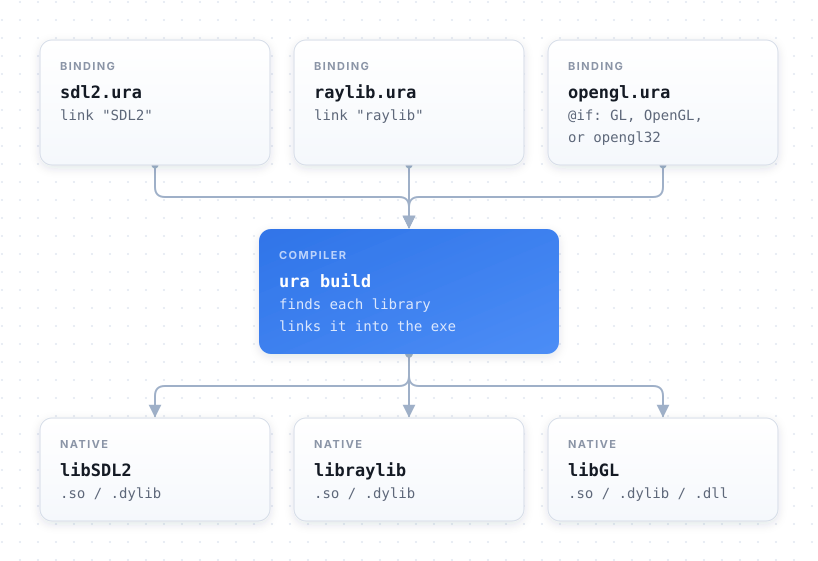
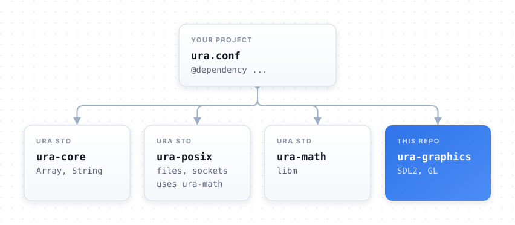

<p align="center">
  
</p>

<h1 align="center">ura-graphics</h1>

<p align="center">
  Windows, pixels and games for <a href="https://github.com/ura-computing/ura-lang">ura</a>: SDL2, raylib and OpenGL bindings.<br>
  Open a window, fill a pixel buffer, draw shapes and text, all from ura.
</p>

<p align="center">
  
  
  
  
  
</p>

---

## At a glance

A 320x200 plasma, written straight into a pixel buffer:

```ura
use "@/core"
use "@/graphics/sdl2"

W i32 = 320
H i32 = 200

fn main() i32:
    window Window = Window::create("ura plasma", W, H)
    pixels Array<Color>
    pixels.resize(W * H)
    event Event
    frames i32 = 0

    while window.is_open() and frames < 180:
        while window.poll(&event):
            if event.kind == EventKind::KEY_DOWN and event.key == Key::ESCAPE:
                window.close()
        for y in Range::create(0, H):
            for x in Range::create(0, W):
                pixels[y * W + x] = Color::create(
                    ((x + frames) % 256) as u8,
                    ((y + frames / 2) % 256) as u8,
                    ((x + y + frames) % 256) as u8,
                    255
                )
        window.draw(pixels)
        window.present()
        frames += 1

    io::out($"drew {frames} frames of {W}x{H} pixels\n")
    return 0
```

- Change one line to change the backend: `use "@/graphics/opengl"` or `use "@/graphics/raylib"`. The rest stays the same.
- `Color` is 4 bytes, `r g b a` in memory: every backend takes `pixels.data` with no copy and no repacking.
- `Window::create` throws an `Error` with the backend's own message when it can't open; the window is freed when it goes out of scope.

## Install

```
ura deps add graphics@0.0.1
```

It adds this block to your project's `ura.conf`. The C library itself comes from your system (`apt install libsdl2-dev`, `brew install sdl2 raylib`).

```ura
@dep "graphics":
    @url "https://github.com/ura-computing/ura-graphics"
    @version "0.0.1"
```

## Frame pipeline

```
 ura                                   SDL2                          screen
┌────────────────────────┐   .data   ┌──────────────────────┐      ┌────────┐
│ pixels Array<Color>    │ ────────► │ SDL_UpdateTexture    │      │        │
│ [RGBA][RGBA][RGBA] ... │  no copy  │ texture (GPU)        │ ───► │ window │
│ W * H elements         │           │ SDL_RenderCopy       │      │        │
└────────────────────────┘           │ SDL_RenderPresent    │      └────────┘
          ▲                          └──────────────────────┘
          └──────────── for y, for x: compute each pixel, every frame
```

<picture>
  <source media="(prefers-color-scheme: dark)" srcset="assets/pipeline-dark.svg">
  
</picture>

## API quick reference

Every backend gives the same types:

| Type | API |
|---|---|
| `Window` | `Window::create(title, width, height)` `is_open()` `close()` `poll(&event) bool` `draw(pixels Array<Color>)` `present()` `set_title(title)` |
| `Color` | `Color::create(r, g, b, a)` (`u8` each), `packed() u32` |
| `Event` | `kind EventKind` (`NONE` `QUIT` `KEY_DOWN` `KEY_UP`), `key Key` (`ESCAPE` `SPACE` `UP` `DOWN` `LEFT` `RIGHT` `PAGE_UP` `PAGE_DOWN` `A` `D` `P` `R` `S` `W`) |

| Backend | Import | Raw C bindings | Notes |
|---|---|---|---|
| sdl2 | `use "@/graphics/sdl2"` | `SDL2::SDL_CreateWindow` `SDL2::SDL_PollEvent` ... | windows, pixels, keyboard, mouse, timers |
| opengl | `use "@/graphics/opengl"` | `OpenGL::glClear` `OpenGL::glBegin` ... | classic OpenGL 1.x in an SDL2 window |
| raylib | `use "@/graphics/raylib"` | `Raylib::InitWindow` `Raylib::DrawText` ... | a `Color` argument is passed as `color.packed()` |

<details>
<summary><b>sdl2</b>: every binding, in <code>mod SDL2</code></summary>

| Area | Functions | Constants |
|---|---|---|
| setup | `SDL_Init` `SDL_Quit` `SDL_GetError` | `SDL_INIT_TIMER` `SDL_INIT_AUDIO` `SDL_INIT_VIDEO` `SDL_INIT_EVENTS` |
| windows | `SDL_CreateWindow` `SDL_DestroyWindow` `SDL_SetWindowTitle` `SDL_GetWindowSize` `SDL_ShowCursor` | `SDL_WINDOWPOS_CENTERED` `SDL_WINDOWPOS_UNDEFINED` `SDL_WINDOW_SHOWN` `SDL_WINDOW_RESIZABLE` `SDL_WINDOW_FULLSCREEN` `SDL_WINDOW_OPENGL` |
| drawing | `SDL_CreateRenderer` `SDL_DestroyRenderer` `SDL_SetRenderDrawColor` `SDL_RenderClear` `SDL_RenderPresent` `SDL_RenderDrawPoint` `SDL_RenderDrawLine` `SDL_RenderDrawRect` `SDL_RenderFillRect` | `SDL_RENDERER_SOFTWARE` `SDL_RENDERER_ACCELERATED` `SDL_RENDERER_PRESENTVSYNC` |
| textures | `SDL_CreateTexture` `SDL_UpdateTexture` `SDL_RenderCopy` `SDL_DestroyTexture` | `SDL_PIXELFORMAT_RGBA8888` `SDL_PIXELFORMAT_ARGB8888` `SDL_TEXTUREACCESS_STATIC` `SDL_TEXTUREACCESS_STREAMING` |
| events | `SDL_PollEvent` `SDL_WaitEvent` | `SDL_QUIT` `SDL_KEYDOWN` `SDL_KEYUP` `SDL_MOUSEMOTION` `SDL_MOUSEBUTTONDOWN` `SDL_MOUSEBUTTONUP` `SDL_WINDOWEVENT` |
| keyboard | `SDL_GetKeyboardState` | `SDL_SCANCODE_W` `A` `S` `D` `UP` `DOWN` `LEFT` `RIGHT` `SPACE` `ESCAPE` |
| time | `SDL_GetTicks` `SDL_Delay` | |
| OpenGL context | `SDL_GL_*` | `SDL_GL_DOUBLEBUFFER` `SDL_GL_DEPTH_SIZE` `SDL_GL_CONTEXT_MAJOR_VERSION` `SDL_GL_CONTEXT_PROFILE_CORE`... |

</details>

<details>
<summary><b>raylib</b>: every binding, in <code>mod Raylib</code></summary>

`InitWindow` `CloseWindow` `IsWindowReady` `WindowShouldClose` `SetWindowTitle` `SetExitKey` `SetTargetFPS` `GetFrameTime` `BeginDrawing` `EndDrawing` `ClearBackground` `DrawRectangle` `DrawRectangleLines` `DrawLine` `DrawText` `MeasureText` `IsKeyPressed` `GetKeyPressed` `TextFormat` `SetRandomSeed` `GetRandomValue`, the rlgl texture calls `rlLoadTexture` `rlUpdateTexture` `rlUnloadTexture` `rlSetTexture` `rlBegin` `rlEnd` `rlColor4ub` `rlTexCoord2f` `rlVertex2f`, and the `KEY_*` keys.

No raylib call takes a struct by value: a `Color` goes as its `packed()` `u32`, and textures go by their rlgl id.

</details>

<details>
<summary><b>opengl</b>: classic OpenGL 1.x, in <code>mod OpenGL</code></summary>

| Area | Functions |
|---|---|
| frame | `glClearColor` `glClear` `glViewport` `glFlush` `glFinish` `glGetError` `glGetString` |
| state | `glEnable` `glDisable` `glBlendFunc` `glPointSize` `glLineWidth` |
| matrices | `glMatrixMode` `glLoadIdentity` `glOrtho` `glTranslatef` `glRotatef` `glScalef` `glPushMatrix` `glPopMatrix` |
| drawing | `glBegin` `glEnd` `glVertex*` `glColor*` `glTexCoord*` |
| textures | `glGenTextures` `glDeleteTextures` `glBindTexture` `glTexParameteri` `glTexImage*` `glTexSubImage*` |

The library to link is picked per system with `@if`: `GL` on Linux, `OpenGL` on macOS, `opengl32` on Windows. Pair it with `SDL_WINDOW_OPENGL` and the `SDL_GL_*` attributes from sdl2.

</details>

## The ura standard library

<picture>
  <source media="(prefers-color-scheme: dark)" srcset="assets/ecosystem-dark.svg">
  
</picture>

| Repo | Version | What | Depends on |
|---|---|---|---|
| [ura-core](https://github.com/ura-computing/ura-core) | 0.0.1 | Array, String, Range, Error, Os | nothing |
| [ura-posix](https://github.com/ura-computing/ura-posix) | 0.0.1 | the C library and the OS | ura-math |
| [ura-math](https://github.com/ura-computing/ura-math) | 0.0.1 | C's math library | nothing |
| **ura-graphics** | 0.0.1 | SDL2, raylib, OpenGL | nothing |

---

<p align="center">
  Part of <a href="https://github.com/ura-computing/ura-lang">ura-lang</a>
</p>
